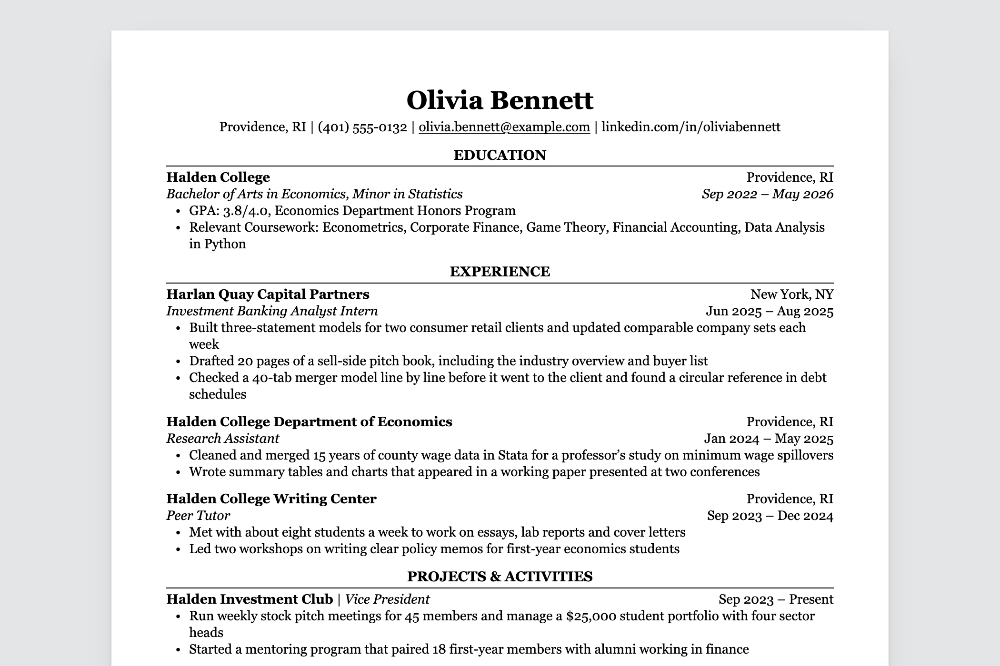

# Readable Resume for Hugo

A one-page resume theme for [Hugo](https://gohugo.io/). You write your resume
in the front matter of one Markdown file and get a web page that prints to a
clean PDF: serif type, centered section headings over a thin rule, education
first. The layout is the Classic template from
[ReadableResume](https://readableresume.com/templates/classic), where the same
design is available for Google Docs and Word. There's also a
[Zola version](https://github.com/supertj/zola-readable-resume) of this theme.



Everything sits in one column with no tables, text boxes or icons, and the HTML
follows reading order, so the text comes out of the PDF in the order you read
it. That's the text applicant tracking systems parse.

The page is a single HTML file with the CSS inline. No JavaScript, no web
fonts, nothing else to serve.

## Installation

You need Hugo 0.128.0 or later. The standard edition is enough.

Start a site and add the theme as a git submodule:

```sh
hugo new site my-resume
cd my-resume
git init
git submodule add https://github.com/supertj/readable-resume-hugo.git themes/readable-resume-hugo
cp themes/readable-resume-hugo/exampleSite/content/_index.md content/
```

Then replace what's in `hugo.toml` with this:

```toml
baseURL = "https://example.com/"
title = "Resume"
theme = "readable-resume-hugo"

# The resume is a single page, so skip the pages Hugo makes for blogs
disableKinds = ["taxonomy", "term", "section", "page", "rss"]

[params]
  resume_paper = "letter"
```

Run `hugo server` and open http://localhost:1313. The page reloads every time
you save `content/_index.md`.

To try the sample first without making a site, clone this repository and run
`hugo server -s exampleSite` from its folder.

If you use Hugo Modules instead of a submodule, import
`github.com/supertj/readable-resume-hugo` in place of the `theme` line.

## Editing your resume

Everything on the page comes from the front matter of `content/_index.md`,
between the two `+++` lines. It's TOML, so text goes in quotes:

```toml
title = "Olivia Bennett"
description = "Resume of Olivia Bennett, an economics student at Halden College."

[params]
contact = [
  "Providence, RI",
  "(401) 555-0132",
  "olivia.bennett@example.com",
  "linkedin.com/in/oliviabennett",
]

[[params.sections]]
title = "Experience"

[[params.sections.entries]]
company = "Harlan Quay Capital Partners"
location = "New York, NY"
title = "Investment Banking Analyst Intern"
date = "Jun 2025 – Aug 2025"
bullets = [
  "Built three-statement models for two consumer retail clients",
  "Drafted 20 pages of a sell-side pitch book",
]
```

YAML front matter between `---` lines works too, with the same field names.

`title` is your name. It goes at the top of the page and in the browser tab.
`description` sets the page's meta description, which search engines may show
in results if you put the page online.

Each `[[params.sections]]` starts a new section, and sections print in the
order you write them. Section titles are set in capitals for you, so type them
however you like.

Each `[[params.sections.entries]]` adds an entry to the section above it.
Whether the entry has a `school`, a `company` or a `name` decides its layout:

| Has | Fields | Layout |
|---|---|---|
| `school` | `school`, `location`, `degree`, `date` | School and location on the first line, degree and dates in italics on the second. |
| `company` | `company`, `location`, `title`, `date` | Company and location first, then the job title in italics with the dates. |
| `name` | `name`, `role`, `date` | One line, "Name \| Role" with the dates on the right. For clubs, volunteering and projects. |

The other fields are optional, and `bullets` works on all three. Leave a field
out and it just isn't printed.

A section can also have `lines`, one per line, which is how the skills section
works. A line with a `label` gets the label in bold, followed by a colon:

```toml
[[params.sections]]
title = "Skills"
lines = [
  { label = "Technical", text = "Excel, PowerPoint, Python (pandas), Stata" },
  { label = "Languages", text = "French (fluent), Spanish (basic)" },
]
```

Or `text`, for a paragraph such as a short summary. Use triple quotes if it
runs over several lines:

```toml
[[params.sections]]
title = "Summary"
text = "Economics graduate with two years of research experience in labor data."
```

Inline Markdown works in all of these: `**bold**`, `*italic*` and
`[links](https://example.com)`. Hugo also turns straight quotes into curly
ones and `--` into an en dash.

In the contact line, email addresses and anything starting with `https://`
become links. To link shorter text, write the item as a table with a `url`:

```toml
contact = [
  "Providence, RI",
  { text = "github.com/oliviabennett", url = "https://github.com/oliviabennett" },
]
```

A `url` has to start with `https://`, `http://`, `mailto:` or `tel:`. The text
of a link like this, and your name in `title`, are printed as typed, without
Markdown.

Field names are lowercase. A misspelled field name in a section, an entry, a
line or a contact item stops the build with a message saying which field and
where, rather than quietly leaving something off your resume.

## Printing to PDF

Open the page in Chrome or Edge, press Ctrl+P (Cmd+P on a Mac), choose
**Save as PDF**, and untick **Headers and footers** under More settings. The
paper size and margins come from the page itself.

Set `resume_paper = "a4"` under `[params]` for A4. The margins switch from
0.6 in to 15 mm, the same as the Google Docs original.

Firefox and Safari print it too. Check that the paper size in their print
dialog matches, since they don't always pick it up from the page.

## Configuration

| Setting | Default | What it does |
|---|---|---|
| `resume_paper` under `[params]` | `"letter"` | `"letter"` or `"a4"`. Sets the page size and margins for printing, and the size of the sheet on screen. |

## Changing the design

The theme has one page template and one stylesheet:

- `layouts/partials/style.html` has all the CSS. Font sizes are in points so
  the printed page matches the original.
- `layouts/index.html` builds the page from the front matter.

To change either one, copy it into the same path in your own site and edit it
there. Hugo uses your copy instead of the theme's.

To add something without copying a whole file, create one of these in your
site's `layouts/partials/hooks/`. They're empty in the theme:

- `head-end.html`: extra tags at the end of `<head>`, such as another
  stylesheet.
- `before-resume.html` and `after-resume.html`: content above or below the
  sheet. Hide it in print with `@media print` if it shouldn't end up in the
  PDF.

## Fonts

The design uses Georgia, which comes with Windows and macOS, so there's nothing
to install on those systems. Elsewhere, such as Linux or Android, the browser
falls back to Gelasio if you have it installed (it's free on Google Fonts and
drawn to Georgia's proportions), then to Times New Roman or the default serif.
A different font can change the line breaks, so print from a computer that has
Georgia if the page is close to full.

## Putting it online

Set `baseURL` in `hugo.toml` to the address the site will live at, then run
`hugo`. The page ends up in `public/index.html`, next to a `sitemap.xml`.

The page shows everything in your contact line, phone number included, so check
that before you publish it.

## License

MIT. The person, schools and companies in the sample are made up.
